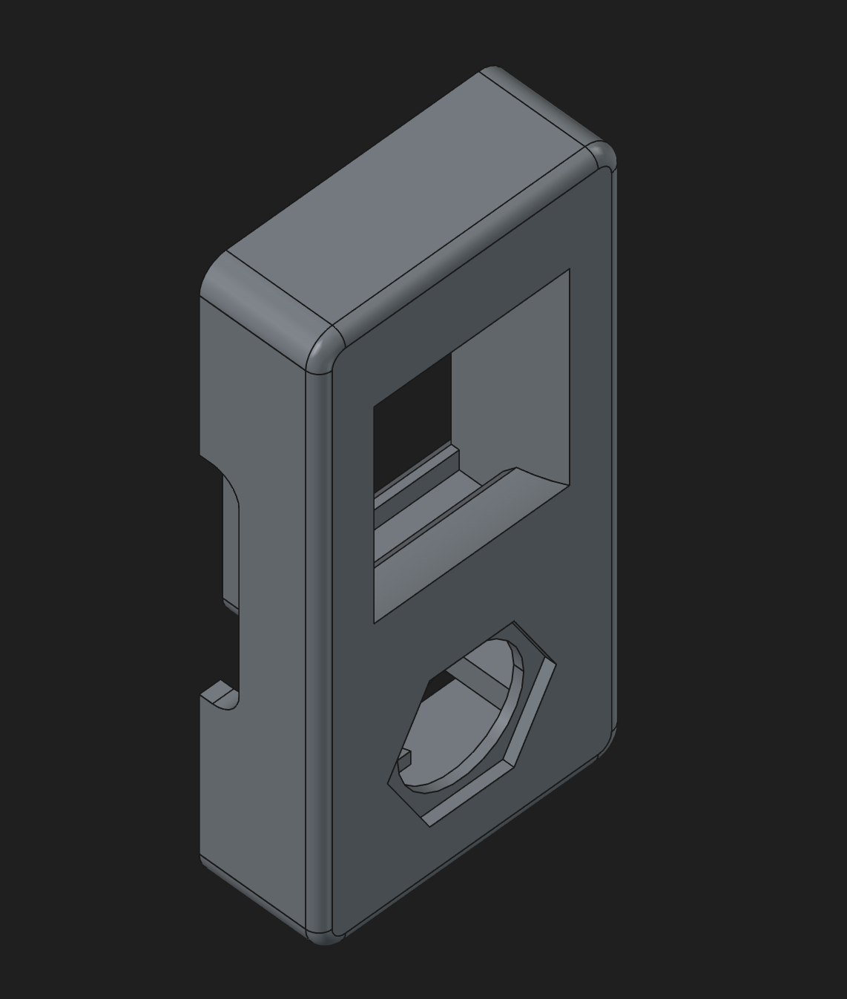

BJC Sol compatible cover plates
===============================

A collection of faceplate covers for the BJC Sol series sockets.

Available on Printables: https://www.printables.com/model/1874649-bjc-sol-compatible-cover-plates

BjcHalfCovers.FCStd
-------------------

Half-width / narrow cover plates.

| Body                  | Description
|--------------------   |---------------------------------------------------------
| BlankCover            | Cover without any cutouts
| RJ11Cover             | Cover that fits the mechanism of the BJC RJ-11 adapter
| TypeFBulkHeadCover    | Cover with a cutout for type-F bulkhead connector (TV antenna)
| KeystoneCover         | Cover with a cutout for Keystone modules (e.g. Ethernet RJ-45)
| KeystoneAndTypeFCover | Cover with both a cutout for type-F bulkhead connectors and keystone modules

Photos

BJCSolClip.FCStd
----------------

Replacement clip to hold the cover plates in.

[BJC Sol]: https://bjc.es/en/sol/#
